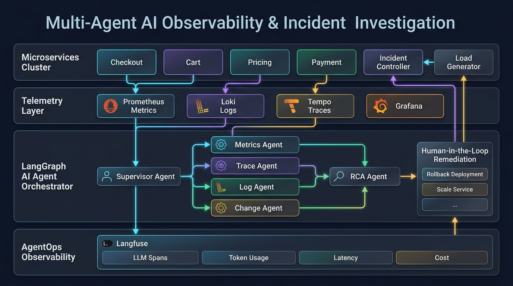
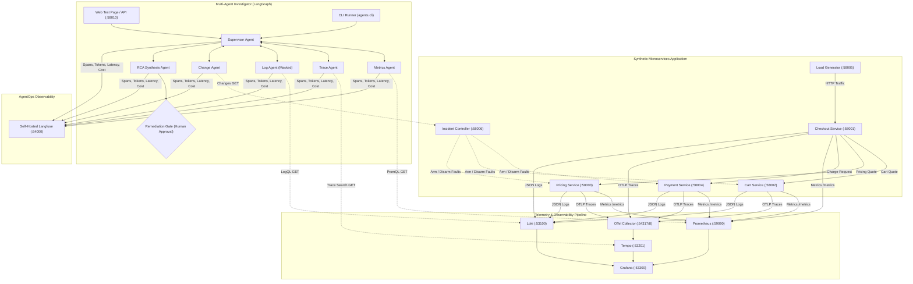
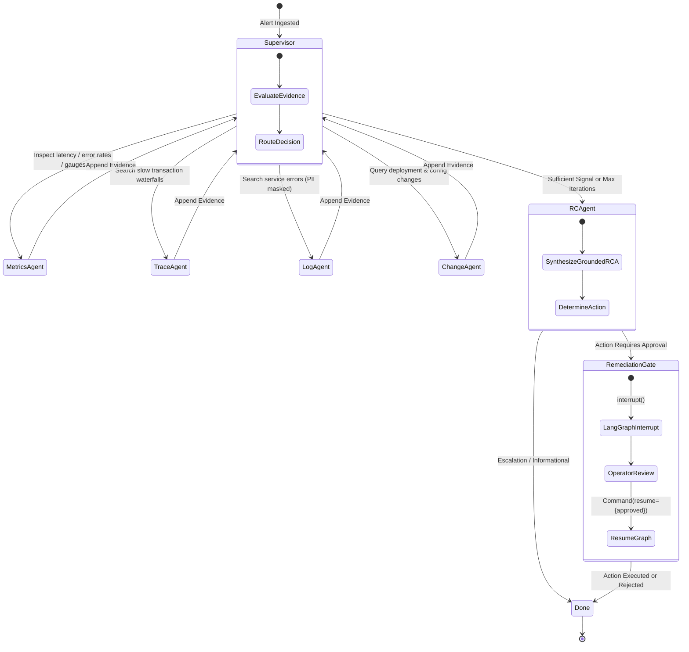

# Multi-Agent AI for Observability & Incident Investigation

[](https://www.python.org/downloads/)
[](https://github.com/langchain-ai/langgraph)
[](https://opentelemetry.io/)
[](https://langfuse.com/)
[](https://opensource.org/licenses/MIT)

An enterprise-grade, autonomous **multi-agent AI platform** built with **LangGraph** that investigates synthetic production microservices incidents, correlates distributed telemetry (metrics, traces, structured logs, and deployment change events), produces a grounded root-cause analysis (RCA), enforces human approval gates for remediation, and traces its own reasoning via self-hosted **Langfuse (AgentOps)**.

---

## 🏛️ System Architecture



The project is decoupled into two independent systems:
1. **Synthetic Application & Control Plane**: Generates realistic telemetry and exposes deterministic fault-injection primitives.
2. **LangGraph Multi-Agent Investigator**: Reads telemetry strictly read-only, correlates evidence, and produces a structured RCA.

### 1. End-to-End System Topology



---

### 2. LangGraph Hub-and-Spoke State Machine



---

### 3. Two-Tier Observability Model

The system establishes two distinct, decoupled observability loops:

```
┌─────────────────────────────────────────────────────────────┐
│ Tier 1: Application Observability                           │
│ Microservices ──► Metrics, Traces, Logs ──► Prometheus/Loki │
└──────────────────────────────┬──────────────────────────────┘
                               │ Inspected by AI Agents
                               ▼
┌─────────────────────────────────────────────────────────────┐
│ Tier 2: AgentOps Observability                              │
│ AI Agents ──► Execution Traces, Tokens, Cost ──► Langfuse   │
└─────────────────────────────────────────────────────────────┘
```

---

## ⚡ Quickstart Guide

### Prerequisites
- **Docker Desktop** (with Docker Compose v2+)
- **Python 3.12**
- **OpenAI API Key**

### 1. First-Time Setup
Run the idempotent environment setup script:
```powershell
.\scripts\setup-env.ps1
```
This initializes the `.venv` virtual environment, installs dependencies, and generates `.env` from `.env.example`.

**Edit `.env`** and enter your `OPENAI_API_KEY`:
```ini
OPENAI_API_KEY=sk-...your-real-key...
```

### 2. Start the Observability & Application Stack
```powershell
.\scripts\start-all.ps1
```
Brings up all 12 containers on their dedicated `5xxxx` ports. Check status anytime with:
```powershell
.\scripts\status.ps1
```

### 3. Launch the Interactive Web Test Page
To interact with the investigator, arm faults, watch real-time multi-agent reasoning, and inspect live Langfuse links:
```powershell
.\scripts\start-ui.ps1
```
Open **[http://localhost:58010](http://localhost:58010)** in your browser:
- **Scenario Library**: Click any of the 10 preset incident scenarios.
- **Live Topology**: Watch Supervisor and Specialist nodes illuminate in real time.
- **Evidence Stream**: View live PromQL, LogQL, and Tempo trace citations with PII redacted.
- **Human Approval Modal**: Interactively approve or reject proposed remediation actions.
- **Langfuse Deep Link**: Direct one-click access to the full AgentOps execution trace.

---

### 4. Running the CLI End-to-End Demo
To execute the worked example from the specification (INC-01: Payment Service DB pool exhaustion):
```powershell
.\scripts\run-demo.ps1 -Incident INC-01
```
This arms the fault, drives synthetic load, runs the LangGraph investigator with formatted terminal output, prompts for human approval before applying remediation, and outputs the Langfuse trace URL.

---

### 5. Running the Automated Evaluation Harness
Score the investigator against all 10 ground-truth incident fixtures across 6 evaluators:
```powershell
.\scripts\run-eval.ps1
```
Evaluates:
1. **RCA Accuracy**: Evaluates root-cause accuracy against scenario ground truth.
2. **Evidence Grounding**: Confirms claims cite real telemetry without hallucination.
3. **Tool Selection (F1)**: Compares queried telemetry tools against expected sources.
4. **Investigation Path**: Scores logical sequencing and supervisor iteration efficiency.
5. **Hallucination Resistance**: Flags unsupported numeric or factual assertions.
6. **Efficiency**: Measures total tool calls, duration, and latency.

### 6. AgentOps Regression Comparison
Compare two versions to measure prompt/model improvements over time:
```powershell
python eval\compare_runs.py v1-baseline v2-tuned
```
Example regression report:
```
------------ AgentOps Regression Analysis: v1-baseline vs v2-tuned ------------
                       Performance & Accuracy Comparison                       
+-----------------------------------------------------------------------------+
|                      |      v1-baseline      |                      |       |
| Metric               |      (Baseline)       | v2-tuned (Candidate) | Delta |
|----------------------+-----------------------+----------------------+-------|
| RCA Accuracy         |          70%          |         90%          | +20%  |
| Evidence Grounding   |          82%          |         94%          | +12%  |
| Tool Selection F1    |          78%          |         92%          | +14%  |
| Investigation Path   |          75%          |         90%          | +15%  |
| Hallucination        |          88%          |         96%          |  +7%  |
| Resistance           |                       |                      |       |
| Avg Latency          |         28.0s         |        19.0s         | -9.0s |
+-----------------------------------------------------------------------------+
```

### 7. Running Unit Tests
Validate all components offline with pytest:
```powershell
.\.venv\Scripts\python.exe -m pytest tests/ -v
```

---

## 🔌 Fixed Port Mapping

All services are bound to fixed `5xxxx` ports to prevent local port collisions.
The table below covers the services you'll actually interact with directly;
see **[docs/ports.md](docs/ports.md)** for the complete list including
Langfuse's backing services (Postgres, ClickHouse, Redis, MinIO).

| Service | Port | Description |
| :--- | :--- | :--- |
| **Web Test Page & API** | `58010` | Interactive UI & investigation streaming server (`agents-api`) |
| **Langfuse Web** | `54000` | AgentOps tracing UI, session analytics, LLM calls |
| **Grafana** | `53300` | Pre-configured telemetry dashboards |
| **Prometheus** | `59090` | Time-series metrics server |
| **Loki** | `53100` | Structured JSON log indexing server |
| **Tempo** | `53201` | Distributed trace search API |
| **OTel Collector** | `54317` / `54318` | gRPC & HTTP trace receivers |
| **incident-controller** | `58006` | Fault injection control plane & change-log API |
| **checkout-service** | `58001` | Microservice entrypoint |
| **cart-service** | `58002` | Item calculation microservice |
| **pricing-service** | `58003` | Price quote microservice |
| **payment-service** | `58004` | Transaction & DB pool microservice |
| **load-generator** | `58005` | Synthetic traffic generator |

---

## 🎯 Ground-Truth Incident Scenarios

The test matrix covers 10 distinct, reproducible failure modes:

| Scenario | Target Service | Fault Type | Ground Truth Root Cause |
| :--- | :--- | :--- | :--- |
| **INC-01** | `payment-service` | `db_pool_exhaustion` | DB connection pool exhaustion after deployment v4.18.2 reduced pool size to 2. |
| **INC-02** | `pricing-service` | `cpu_load` | High background CPU contention starving request threads. |
| **INC-03** | `cart-service` | `memory_leak` | Progressive memory leak causing process latency degradation. |
| **INC-04** | `cart-service` | `error_rate` | Probabilistic 500 exceptions on cart calculations following bad deploy. |
| **INC-05** | `pricing-service` | `latency` | Downstream API timeout/slowdown injecting fixed request delays. |
| **INC-06** | `payment-service` | `lock_contention` | Heavy database row lock wait timeouts during transaction charge. |
| **INC-07** | `payment-service` | `restart_on_oom` | Memory growth exceeding threshold triggering container OOM restarts. |
| **INC-08** | `checkout-service` | `none` (traffic spike) | Massive traffic surge saturating downstream services. |
| **INC-09** | `pricing-service` | `config_error` | Invalid `PRICING_STRATEGY` configuration setting. |
| **INC-10** | `cart-service` | `exception` | Unhandled `KeyError` bug in cart indexing. |

---

## 🔒 Enterprise Considerations

1. **Read-Only Telemetry**: Specialist agent tools for Prometheus, Loki, Tempo, and Changes are strictly GET-only.
2. **Sensitive Data Redaction**: Log lines returned by Loki pass through `agents/masking.py` to scrub credit cards, email addresses, and JWT tokens before reaching graph state or LLM prompts.
3. **Human Approval Gate**: Any mutating production action (restarting a container, changing pool sizes) triggers a LangGraph `interrupt()`, halting execution until an operator explicitly approves or rejects the action.
4. **Auditability**: Every agent decision, LLM call, token count, and latency is recorded in Langfuse for compliance and post-mortem review.

---

## 📄 License
This project is licensed under the [MIT License](LICENSE).
