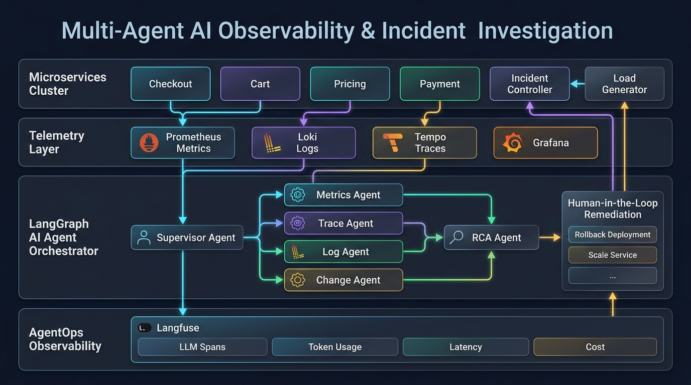

# Architecture

## Overview



Two independent systems, deliberately decoupled:

1. **The synthetic application** (checkout/cart/pricing/payment + a fault-injection
   control plane) generates real metrics, logs, and traces, and can be made to
   fail in specific, known ways.
2. **The investigator** (a LangGraph multi-agent system) queries that
   telemetry read-only, correlates evidence, and produces a grounded RCA -
   itself fully traced via Langfuse.

The evaluation harness closes the loop: it arms a known fault, runs the
investigator, and scores the result against stored ground truth.

## Synthetic application

```
checkout-service (8001)
  -> cart-service (8002)      "compute cart total"
  -> pricing-service (8003)   "compute price quote"
  -> payment-service (8004)   "charge" (owns the simulated DB connection pool)

incident-controller (8000/58006 host)
  - the ONLY fault-injection control plane
  - POST /control/incidents/{id}/start|stop  -> arms/disarms a fault on the
    target service via that service's internal /admin/fault endpoint, and
    records a change-log entry
  - GET /control/changes, /control/status    -> read-only, this is the only
    thing the Change Agent is allowed to see

load-generator (8005)
  - drives configurable-rps traffic through checkout-service
  - POST /admin/start {rps}, /admin/stop, GET /admin/status
```

Every service emits:
- **Metrics** via `prometheus_client` (`/metrics`): request latency histogram,
  request counter, plus service-specific gauges (`payment_db_pool_active`,
  `payment_db_pool_size`, `service_restarts_total`) and the standard process
  collector (CPU, RSS).
- **Traces** via OpenTelemetry OTLP -> otel-collector -> Tempo.
- **Logs** as structured JSON, pushed directly to Loki, labeled `service=<name>`.

Fault injection is built from five reusable primitives (`libs/telemetry/telemetry/faults.py`):
semaphore/pool exhaustion, fixed-latency injection, probabilistic
error/exception injection, real resource pressure (CPU busy-loop threads,
memory-ballast growth), and load-generator-driven traffic spikes. The 10
incident fixtures under `eval/incidents/` combine these to reproduce the
spec's 10 ground-truth incident types, with INC-01 (DB pool exhaustion) built
to full fidelity matching the spec's worked example.

## LangGraph investigator (`agents/`)

Hub-and-spoke graph: a `supervisor` node (structured-output routing) hands
off to one of four single-tool specialist agents (`metrics_agent`,
`trace_agent`, `log_agent`, `change_agent`), each backed by a strictly
read-only (GET-only) tool against Prometheus, Tempo, Loki, and
incident-controller's `/control/changes` respectively. Findings accumulate as
`Evidence` in shared graph state. Once enough evidence is gathered (or an
iteration cap is hit), the supervisor routes to `rca_agent`, which produces a
structured `RCAResult` (root cause, confidence, evidence citations,
recommended action). If the RCA recommends a production action, a
`remediation` node pauses the graph (`interrupt()`) for human approval before
the one mutating tool in the whole codebase (`apply_action`) can ever run.

Every log line returned by the Log Agent's tool is passed through
`agents/masking.py` before it reaches the LLM or graph state, redacting
emails, card numbers, and JWT-looking tokens.

Every graph run is wrapped in a Langfuse `CallbackHandler`, giving one trace
per investigation with the full supervisor -> specialist -> tool-call -> RCA
span tree, tokens, latency, and cost.

## AgentOps (Langfuse)

Self-hosted (Postgres + ClickHouse + Redis + MinIO + langfuse-web +
langfuse-worker), auto-provisioned on first boot via `LANGFUSE_INIT_*` env
vars - no manual signup step. `CLICKHOUSE_CLUSTER_ENABLED=false` because this
is a single-node ClickHouse without Zookeeper.

## Evaluation (`eval/`)

10 YAML fixtures (`eval/incidents/INC-01.yaml` .. `INC-10.yaml`) each define
an alert, a fault to arm (service/type/params/change-log), a load profile
(`load_rps`, `duration_seconds`), and ground truth (root cause, required
evidence, expected tools, expected action). `eval/run_eval.py` arms each
incident live against the running synthetic app, waits for telemetry to
accumulate, runs the graph, and scores it with six evaluators (RCA accuracy,
evidence grounding, tool selection, investigation path, hallucination,
efficiency). Results are tagged by `AGENT_VERSION` so `eval/compare_runs.py`
can produce the before/after regression table the spec asks for.

## Fixed ports

See `docs/ports.md`. All host ports are in the `5xxxx` range by request; two
were shifted off their natural default because unrelated pre-existing local
processes already held them, and one (Langfuse Postgres) was moved off a
Windows Hyper-V/WSL reserved port range.
